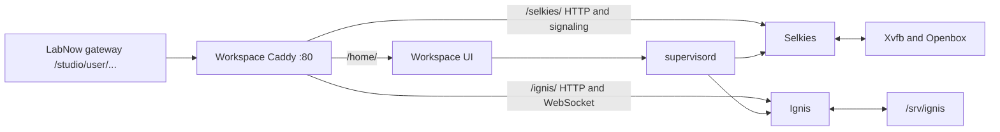

# LabNow workspace images

Use [.github/workflows/build-docker.yml](../../../.github/workflows/build-docker.yml) for the build arguments and pinned base digests. Use the LabNow Shell workspace templates Skill for the Console, Launcher, SSH preview, and shared deployments.

## Runtime

The two targets run in separate containers. [The Dockerfile](../../../src/labnow-open.Dockerfile) adds the shared Caddy and workspace UI to the selected base image. Launcher supplies `URL_PREFIX`. Keep the Caddy route, supervisor program name, and [workspace UI service definition](../../../src/labnow-open-web/src/api/programDefinitions.js) consistent with the Shell service link.

| Target | Build and runtime checks |
| --- | --- |
| `gui` | The pinned `gui-linux` base provides Selkies. Supervisor starts it in WebRTC mode. The `/selkies/` path carries the page and signaling. ICE selects a separate path for video and input. Test that the browser decodes frames and can run `uname -s` in the desktop terminal. |
| `ignis` | The pinned base contains the upstream checkout in `/app`. The build checks the commit, applies [workspace.patch](../../../src/ignis/workspace.patch), and rebuilds Ignis. [The startup script](../../../src/ignis/start-ignis-workspace.sh) requires a mounted `/srv/ignis` and starts the upstream entrypoint. Check the `/ignis/api/vault/list` endpoint under the configured prefix. |

## Build and upgrade

1. Build from the repository root with `-f src/labnow-open.Dockerfile src`, `--target gui` or `--target ignis`, and the corresponding job's `BASE_IMG` and `PROFILE_LOCALIZE` arguments. Use `BASE_NAMESPACE=quay.io/labnow` for the pinned bases. Verify the image on the target architecture using a disposable volume and a non-root `URL_PREFIX` such as `/studio/user/smoke/lab/`.
2. For an Ignis upgrade, keep the base digest, checked upstream commit, and patch aligned. Run `git apply --check` against that commit before rebuilding. `IGNIS_OBSIDIAN_PIN` sets the tested compatibility baseline and the default `OBSIDIAN_VERSION`. With `1.15.1`, the upstream HTML preloads `app.js` and then loads it from an inline script. The workspace patch makes Ignis load the bundle once, after the discovered scripts and its compatibility layer.
3. Start Ignis with a copy of an existing vault and keep the app cache in `/srv/ignis/obsidian-app`. Confirm the cache version from `.obsidian-version`. Open and edit an existing note in the browser, reload, and verify the saved Markdown on disk. The optional headless sync CLI has its own startup and availability checks.
4. Check the GUI and Ignis image jobs individually. Record the actual repository namespace, versioned tag, digest, and mirror result. PR builds can use a different namespace from main. Pass the verified reference to the Shell template catalog.
